# Cross-chip overview (generated)

Generated by `scripts/rdl-extract/cross_chip_diagrams.py` of the hi3520d-nvr workspace; do not edit by hand. Sources: the RDL tree (which common blocks and local block files each chip root includes), `docs/rdl-campaign/block-presence.csv`, `docs/rdl-campaign/driver-status.csv`, `docs/rdl-campaign/SHARED-IP-NOTES.md`, `docs/uboot-driver-audit.md`. Nothing here is hardware-measured except the driver status codes T (tested on a board, only the Hi3520D V100 NVR board and one Hi3518E V200 camera) and W (written, builds, untested).

Naming: the same IP on several chips has one name (the common block name, e.g. HISI_FMC); different IP that does the same job has a different name (e.g. HISI_FEMAC, HISI_GMAC and HISI_HIETH_SF for the Ethernet MAC). A name starting with `local:` is a block layout that exists only in that chip folder.

## SoC family tree

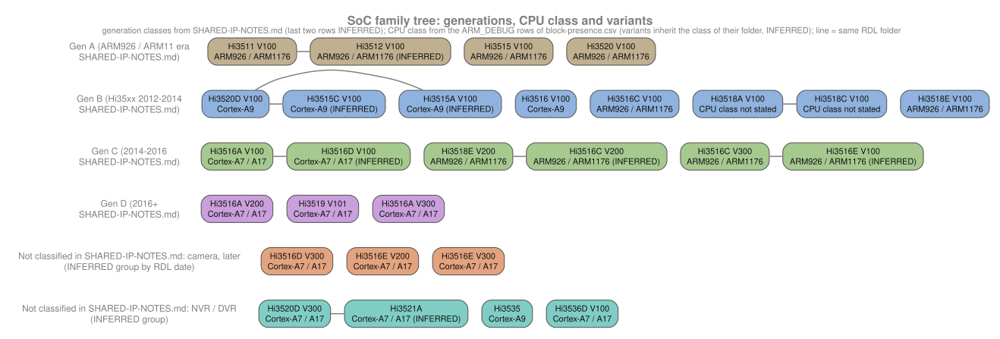

Generation classes are those of `SHARED-IP-NOTES.md` (Gen A-D); chips that note does not classify are grouped by INFERENCE (camera chips of the later Cortex-A7 generation, NVR chips). The CPU class comes from the ARM_DEBUG rows of `block-presence.csv`. Variant edges join chips that share one RDL folder (same data sheet).

| Chip | Generation group | CPU class | RDL folder |
|---|---|---|---|
| Hi3511 V100 | Gen A | ARM926 / ARM1176 | rdl/hi3511v100 |
| Hi3512 V100 | Gen A | ARM926 / ARM1176 (INFERRED) | rdl/hi3511v100 |
| Hi3515 V100 | Gen A | ARM926 / ARM1176 | rdl/hi3515v100 |
| Hi3520 V100 | Gen A | ARM926 / ARM1176 | rdl/hi3520v100 |
| Hi3520D V100 | Gen B | Cortex-A9 | rdl/hi3520dv100 |
| Hi3515A V100 | Gen B | Cortex-A9 (INFERRED) | rdl/hi3520dv100 |
| Hi3515C V100 | Gen B | Cortex-A9 (INFERRED) | rdl/hi3520dv100 |
| Hi3516 V100 | Gen B | Cortex-A9 | rdl/hi3516v100 |
| Hi3516C V100 | Gen B | ARM926 / ARM1176 | rdl/hi3516cv100 |
| Hi3518A V100 | Gen B | not stated | rdl/hi3518v100 |
| Hi3518C V100 | Gen B | not stated | rdl/hi3518v100 |
| Hi3518E V100 | Gen B | ARM926 / ARM1176 | rdl/hi3518ev100 |
| Hi3516A V100 | Gen C | Cortex-A7 / A17 | rdl/hi3516av100 |
| Hi3516D V100 | Gen C | Cortex-A7 / A17 (INFERRED) | rdl/hi3516av100 |
| Hi3518E V200 | Gen C | ARM926 / ARM1176 | rdl/hi3518ev200 |
| Hi3516C V200 | Gen C | ARM926 / ARM1176 (INFERRED) | rdl/hi3518ev200 |
| Hi3516C V300 | Gen C | ARM926 / ARM1176 | rdl/hi3516cv300 |
| Hi3516E V100 | Gen C | ARM926 / ARM1176 (INFERRED) | rdl/hi3516cv300 |
| Hi3516A V200 | Gen D | Cortex-A7 / A17 | rdl/hi3516av200 |
| Hi3519 V101 | Gen D | Cortex-A7 / A17 | rdl/hi3519v101 |
| Hi3516A V300 | Gen D | Cortex-A7 / A17 | rdl/hi3516av300 |
| Hi3516D V300 | Not classified in SHARED-IP-NOTES.md | Cortex-A7 / A17 | rdl/hi3516dv300 |
| Hi3516E V200 | Not classified in SHARED-IP-NOTES.md | Cortex-A7 / A17 | rdl/hi3516ev200 |
| Hi3516E V300 | Not classified in SHARED-IP-NOTES.md | Cortex-A7 / A17 | rdl/hi3516ev300 |
| Hi3520D V300 | Not classified in SHARED-IP-NOTES.md | Cortex-A7 / A17 | rdl/hi3520dv300 |
| Hi3521A | Not classified in SHARED-IP-NOTES.md | Cortex-A7 / A17 (INFERRED) | rdl/hi3520dv300 |
| Hi3535 | Not classified in SHARED-IP-NOTES.md | Cortex-A9 | rdl/hi3535 |
| Hi3536D V100 | Not classified in SHARED-IP-NOTES.md | Cortex-A7 / A17 | rdl/hi3536dv100 |

## IP editions per family

A chip root that includes both a common block and a chip-local data-sheet-exact replacement (files named ds_*.rdl) is drawn with both editions. Each diagram links chips (left) to the edition they use (right). An edition is a common block file or a chip-local block file included by the chip root, plus the editions named by `block-presence.csv` rows. Edition box color: green = a Linux driver with status T exists for at least one chip using it, blue = W only, grey = no row in `driver-status.csv` (this means no driver is recorded, not that none can exist).

### UART

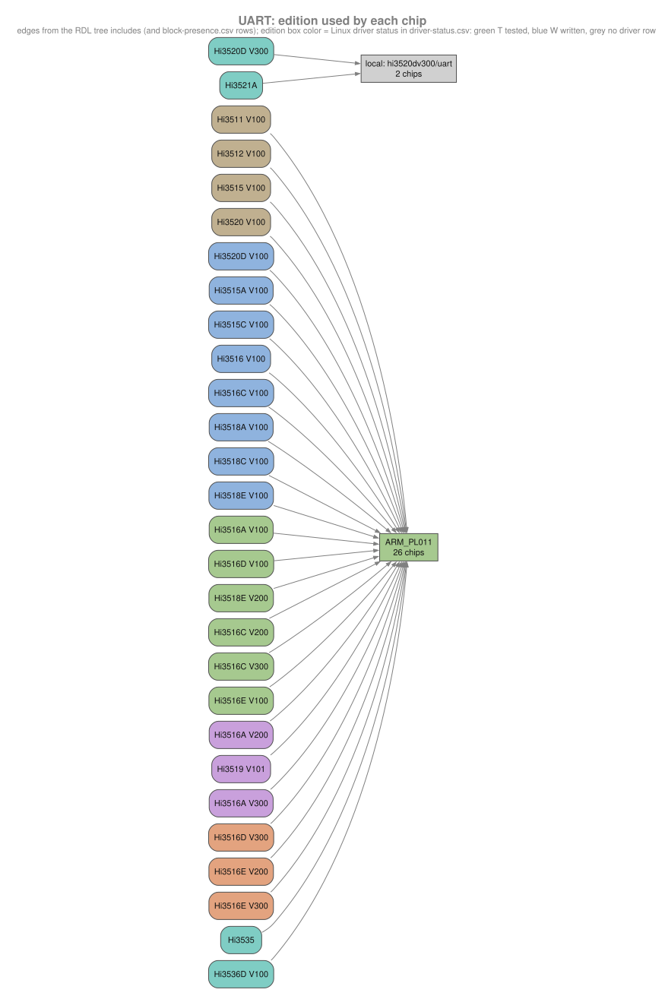

| Edition | Chips | Linux driver status (driver-status.csv) |
|---|---|---|
| ARM_PL011 | Hi3511 V100, Hi3512 V100, Hi3515 V100, Hi3520 V100, Hi3520D V100, Hi3515A V100, Hi3515C V100, Hi3516 V100, Hi3516C V100, Hi3518A V100, Hi3518C V100, Hi3518E V100, Hi3516A V100, Hi3516D V100, Hi3518E V200, Hi3516C V200, Hi3516C V300, Hi3516E V100, Hi3516A V200, Hi3519 V101, Hi3516A V300, Hi3516D V300, Hi3516E V200, Hi3516E V300, Hi3535, Hi3536D V100 | Hi3511 V100 W; Hi3512 V100 W (via folder base, INFERRED); Hi3515 V100 W; Hi3520 V100 W; Hi3520D V100 T; Hi3515A V100 T (via folder base, INFERRED); Hi3515C V100 T (via folder base, INFERRED); Hi3516 V100 W; Hi3516C V100 W; Hi3518A V100 W; Hi3518C V100 W; Hi3516A V100 W; Hi3516D V100 W (via folder base, INFERRED); Hi3518E V200 T; Hi3516C V200 T (via folder base, INFERRED); Hi3516C V300 W; Hi3516E V100 W (via folder base, INFERRED); Hi3516A V200 W; Hi3519 V101 W; Hi3516A V300 W |
| local: hi3520dv300/uart | Hi3520D V300, Hi3521A | none recorded |

Edition differences are described in: `docs/rdl-campaign/hi3520dv300-compare.md`.

### GPIO

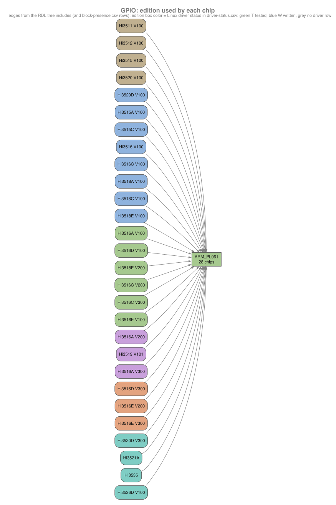

| Edition | Chips | Linux driver status (driver-status.csv) |
|---|---|---|
| ARM_PL061 | Hi3511 V100, Hi3512 V100, Hi3515 V100, Hi3520 V100, Hi3520D V100, Hi3515A V100, Hi3515C V100, Hi3516 V100, Hi3516C V100, Hi3518A V100, Hi3518C V100, Hi3518E V100, Hi3516A V100, Hi3516D V100, Hi3518E V200, Hi3516C V200, Hi3516C V300, Hi3516E V100, Hi3516A V200, Hi3519 V101, Hi3516A V300, Hi3516D V300, Hi3516E V200, Hi3516E V300, Hi3520D V300, Hi3521A, Hi3535, Hi3536D V100 | Hi3511 V100 W; Hi3512 V100 W (via folder base, INFERRED); Hi3515 V100 W; Hi3520 V100 W; Hi3520D V100 T; Hi3515A V100 T (via folder base, INFERRED); Hi3515C V100 T (via folder base, INFERRED); Hi3516 V100 W; Hi3516C V100 W; Hi3518A V100 W; Hi3518C V100 W; Hi3516A V100 W; Hi3516D V100 W (via folder base, INFERRED); Hi3518E V200 T; Hi3516C V200 T (via folder base, INFERRED); Hi3516C V300 W; Hi3516E V100 W (via folder base, INFERRED); Hi3516A V200 W; Hi3519 V101 W; Hi3516A V300 W |

### SPI master

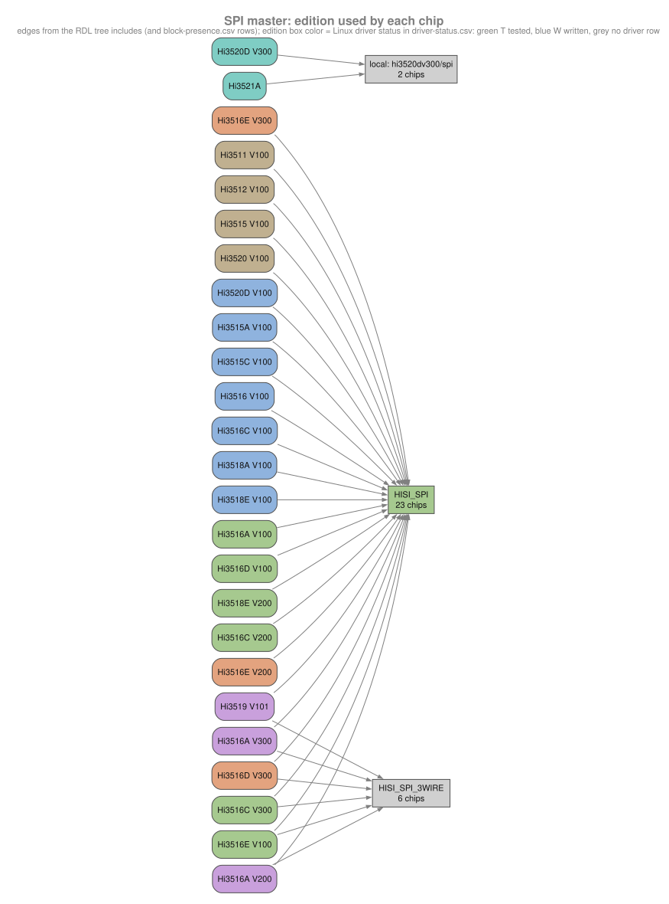

| Edition | Chips | Linux driver status (driver-status.csv) |
|---|---|---|
| HISI_SPI | Hi3511 V100, Hi3512 V100, Hi3515 V100, Hi3520 V100, Hi3520D V100, Hi3515A V100, Hi3515C V100, Hi3516 V100, Hi3516C V100, Hi3518A V100, Hi3518E V100, Hi3516A V100, Hi3516D V100, Hi3518E V200, Hi3516C V200, Hi3516C V300, Hi3516E V100, Hi3516A V200, Hi3519 V101, Hi3516A V300, Hi3516D V300, Hi3516E V200, Hi3516E V300 | Hi3511 V100 W; Hi3512 V100 W (via folder base, INFERRED); Hi3515 V100 W; Hi3520 V100 W; Hi3520D V100 T; Hi3515A V100 T (via folder base, INFERRED); Hi3515C V100 T (via folder base, INFERRED); Hi3516 V100 W; Hi3516C V100 W; Hi3518A V100 W; Hi3516A V100 W; Hi3516D V100 W (via folder base, INFERRED); Hi3518E V200 W; Hi3516C V200 W (via folder base, INFERRED); Hi3516C V300 W; Hi3516E V100 W (via folder base, INFERRED); Hi3516A V200 W; Hi3519 V101 W; Hi3516A V300 W |
| HISI_SPI_3WIRE | Hi3516C V300, Hi3516E V100, Hi3516A V200, Hi3519 V101, Hi3516A V300, Hi3516D V300 | none recorded |
| local: hi3520dv300/spi | Hi3520D V300, Hi3521A | none recorded |

Edition differences are described in: `docs/rdl-campaign/SHARED-IP-NOTES.md`, `docs/rdl-campaign/hi3520dv300-compare.md`.

### I2C

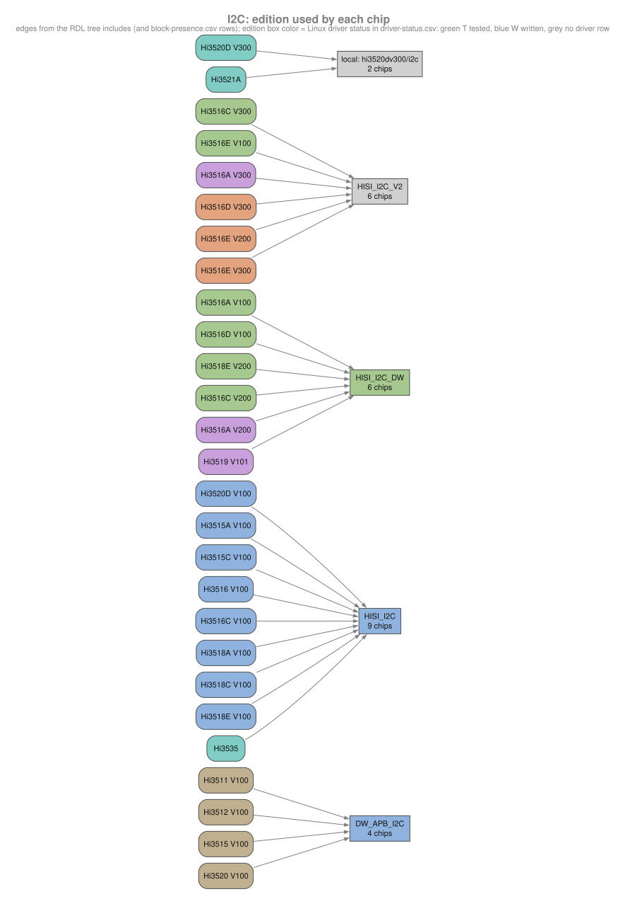

| Edition | Chips | Linux driver status (driver-status.csv) |
|---|---|---|
| DW_APB_I2C | Hi3511 V100, Hi3512 V100, Hi3515 V100, Hi3520 V100 | Hi3511 V100 W; Hi3512 V100 W (via folder base, INFERRED); Hi3515 V100 W; Hi3520 V100 W |
| HISI_I2C | Hi3520D V100, Hi3515A V100, Hi3515C V100, Hi3516 V100, Hi3516C V100, Hi3518A V100, Hi3518C V100, Hi3518E V100, Hi3535 | Hi3520D V100 W; Hi3515A V100 W (via folder base, INFERRED); Hi3515C V100 W (via folder base, INFERRED); Hi3516 V100 W; Hi3516C V100 W; Hi3518A V100 W; Hi3518C V100 W |
| HISI_I2C_DW | Hi3516A V100, Hi3516D V100, Hi3518E V200, Hi3516C V200, Hi3516A V200, Hi3519 V101 | Hi3516A V100 W; Hi3516D V100 W (via folder base, INFERRED); Hi3518E V200 T; Hi3516C V200 T (via folder base, INFERRED); Hi3516A V200 W; Hi3519 V101 W |
| HISI_I2C_V2 | Hi3516C V300, Hi3516E V100, Hi3516A V300, Hi3516D V300, Hi3516E V200, Hi3516E V300 | none recorded |
| local: hi3520dv300/i2c | Hi3520D V300, Hi3521A | none recorded |

Edition differences are described in: `docs/rdl-campaign/SHARED-IP-NOTES.md`, `docs/rdl-campaign/hi3520dv300-compare.md`.

### Flash controller (SFC / FMC / NAND / SMI)

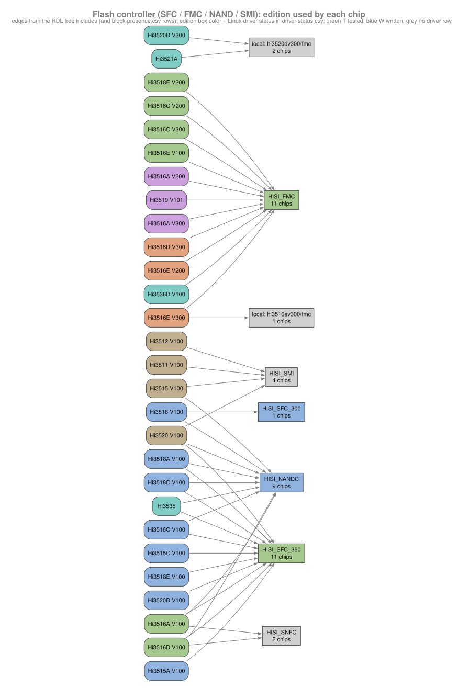

| Edition | Chips | Linux driver status (driver-status.csv) |
|---|---|---|
| HISI_FMC | Hi3518E V200, Hi3516C V200, Hi3516C V300, Hi3516E V100, Hi3516A V200, Hi3519 V101, Hi3516A V300, Hi3516D V300, Hi3516E V200, Hi3516E V300, Hi3536D V100 | Hi3518E V200 T; Hi3516C V200 T (via folder base, INFERRED); Hi3516C V300 W; Hi3516E V100 W (via folder base, INFERRED); Hi3516A V200 W; Hi3519 V101 W; Hi3516A V300 W |
| HISI_NANDC | Hi3515 V100, Hi3520 V100, Hi3516 V100, Hi3516C V100, Hi3518A V100, Hi3518C V100, Hi3516A V100, Hi3516D V100, Hi3535 | Hi3516 V100 W; Hi3516C V100 W; Hi3518A V100 W; Hi3518C V100 W |
| HISI_SFC_300 | Hi3516 V100 | Hi3516 V100 W |
| HISI_SFC_350 | Hi3520 V100, Hi3520D V100, Hi3515A V100, Hi3515C V100, Hi3516C V100, Hi3518A V100, Hi3518C V100, Hi3518E V100, Hi3516A V100, Hi3516D V100, Hi3535 | Hi3520D V100 T; Hi3515A V100 T (via folder base, INFERRED); Hi3515C V100 T (via folder base, INFERRED); Hi3516C V100 W; Hi3518A V100 W; Hi3518C V100 W; Hi3516A V100 W; Hi3516D V100 W (via folder base, INFERRED) |
| HISI_SMI | Hi3511 V100, Hi3512 V100, Hi3515 V100, Hi3520 V100 | none recorded |
| HISI_SNFC | Hi3516A V100, Hi3516D V100 | none recorded |
| local: hi3516ev300/fmc | Hi3516E V300 | none recorded |
| local: hi3520dv300/fmc | Hi3520D V300, Hi3521A | none recorded |

Edition differences are described in: `docs/rdl-campaign/SHARED-IP-NOTES.md`, `docs/rdl-campaign/hi3520dv300-compare.md`.

### Ethernet MAC

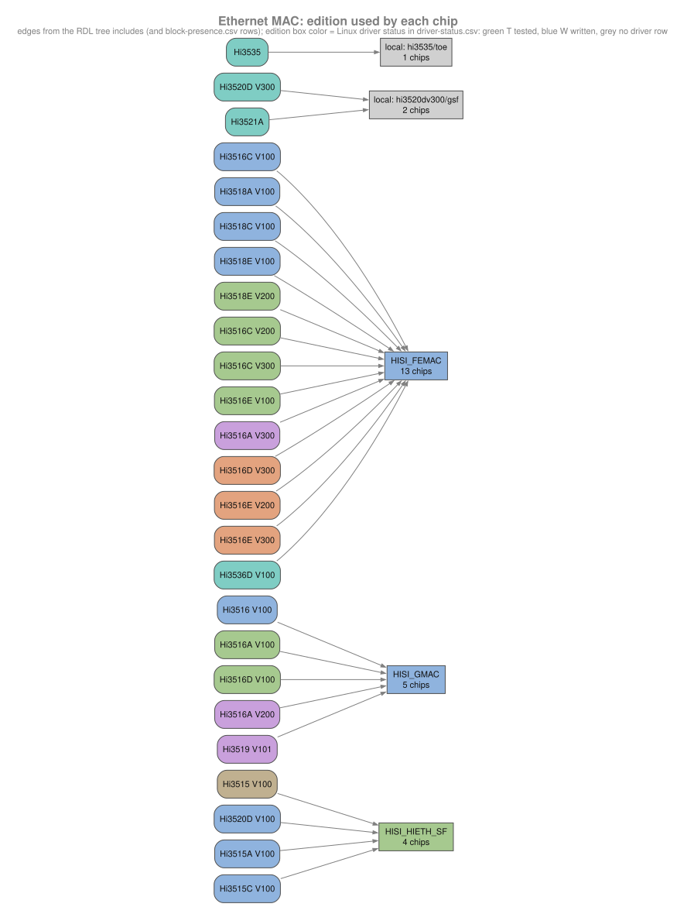

| Edition | Chips | Linux driver status (driver-status.csv) |
|---|---|---|
| HISI_FEMAC | Hi3516C V100, Hi3518A V100, Hi3518C V100, Hi3518E V100, Hi3518E V200, Hi3516C V200, Hi3516C V300, Hi3516E V100, Hi3516A V300, Hi3516D V300, Hi3516E V200, Hi3516E V300, Hi3536D V100 | Hi3516C V100 W; Hi3518A V100 W; Hi3518C V100 W; Hi3518E V200 W; Hi3516C V200 W (via folder base, INFERRED); Hi3516C V300 W; Hi3516E V100 W (via folder base, INFERRED); Hi3516A V300 W |
| HISI_GMAC | Hi3516 V100, Hi3516A V100, Hi3516D V100, Hi3516A V200, Hi3519 V101 | Hi3516A V100 W; Hi3516D V100 W (via folder base, INFERRED); Hi3516A V200 W; Hi3519 V101 W |
| HISI_HIETH_SF | Hi3515 V100, Hi3520D V100, Hi3515A V100, Hi3515C V100 | Hi3515 V100 W; Hi3520D V100 T; Hi3515A V100 T (via folder base, INFERRED); Hi3515C V100 T (via folder base, INFERRED) |
| local: hi3520dv300/gsf | Hi3520D V300, Hi3521A | none recorded |
| local: hi3535/toe | Hi3535 | none recorded |

Edition differences are described in: `docs/rdl-campaign/hi3516dv300-compare.md`, `docs/rdl-campaign/hi3518ev100-compare.md`, `docs/rdl-campaign/hi3520dv300-compare.md`, `docs/rdl-campaign/hi3535-compare.md`.

### USB controller

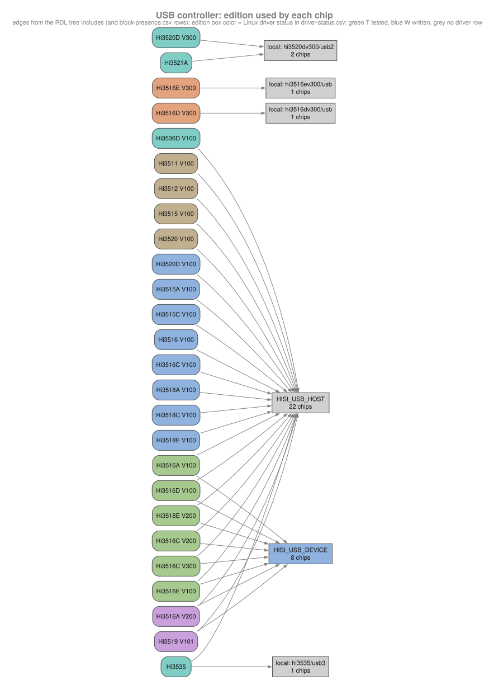

| Edition | Chips | Linux driver status (driver-status.csv) |
|---|---|---|
| HISI_USB_DEVICE | Hi3516A V100, Hi3516D V100, Hi3518E V200, Hi3516C V200, Hi3516C V300, Hi3516E V100, Hi3516A V200, Hi3519 V101 | Hi3516A V100 W; Hi3516D V100 W (via folder base, INFERRED); Hi3518E V200 W; Hi3516C V200 W (via folder base, INFERRED); Hi3516C V300 W; Hi3516E V100 W (via folder base, INFERRED); Hi3516A V200 W; Hi3519 V101 W |
| HISI_USB_HOST | Hi3511 V100, Hi3512 V100, Hi3515 V100, Hi3520 V100, Hi3520D V100, Hi3515A V100, Hi3515C V100, Hi3516 V100, Hi3516C V100, Hi3518A V100, Hi3518C V100, Hi3518E V100, Hi3516A V100, Hi3516D V100, Hi3518E V200, Hi3516C V200, Hi3516C V300, Hi3516E V100, Hi3516A V200, Hi3519 V101, Hi3535, Hi3536D V100 | none recorded |
| local: hi3516dv300/usb | Hi3516D V300 | none recorded |
| local: hi3516ev300/usb | Hi3516E V300 | none recorded |
| local: hi3520dv300/usb2 | Hi3520D V300, Hi3521A | none recorded |
| local: hi3535/usb3 | Hi3535 | none recorded |

Edition differences are described in: `docs/rdl-campaign/hi3520dv300-compare.md`.

### SATA controller

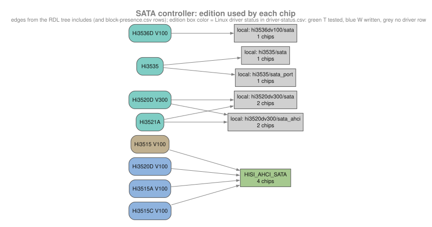

| Edition | Chips | Linux driver status (driver-status.csv) |
|---|---|---|
| HISI_AHCI_SATA | Hi3515 V100, Hi3520D V100, Hi3515A V100, Hi3515C V100 | Hi3520D V100 T; Hi3515A V100 T (via folder base, INFERRED); Hi3515C V100 T (via folder base, INFERRED) |
| local: hi3520dv300/sata | Hi3520D V300, Hi3521A | none recorded |
| local: hi3520dv300/sata_ahci | Hi3520D V300, Hi3521A | none recorded |
| local: hi3535/sata | Hi3535 | none recorded |
| local: hi3535/sata_port | Hi3535 | none recorded |
| local: hi3536dv100/sata | Hi3536D V100 | none recorded |

Edition differences are described in: `docs/rdl-campaign/hi3520dv300-compare.md`, `docs/rdl-campaign/hi3535-compare.md`.

### CRG (clock and reset generator)

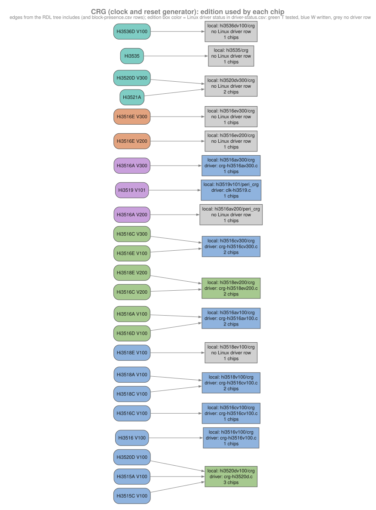

| Edition | Chips | Linux driver status (driver-status.csv) |
|---|---|---|
| local: hi3516av100/crg | Hi3516A V100, Hi3516D V100 | Hi3516A V100 W crg-hi3516av100.c; Hi3516D V100 W (via folder base, INFERRED) crg-hi3516av100.c |
| local: hi3516av200/peri_crg | Hi3516A V200 | none recorded |
| local: hi3516av300/crg | Hi3516A V300 | Hi3516A V300 W crg-hi3516av300.c |
| local: hi3516cv100/crg | Hi3516C V100 | Hi3516C V100 W crg-hi3516cv100.c |
| local: hi3516cv300/crg | Hi3516C V300, Hi3516E V100 | Hi3516C V300 W crg-hi3516cv300.c; Hi3516E V100 W (via folder base, INFERRED) crg-hi3516cv300.c |
| local: hi3516ev200/crg | Hi3516E V200 | none recorded |
| local: hi3516ev300/crg | Hi3516E V300 | none recorded |
| local: hi3516v100/crg | Hi3516 V100 | Hi3516 V100 W crg-hi3516v100.c |
| local: hi3518ev100/crg | Hi3518E V100 | none recorded |
| local: hi3518ev200/crg | Hi3518E V200, Hi3516C V200 | Hi3518E V200 T crg-hi3518ev200.c; Hi3516C V200 T (via folder base, INFERRED) crg-hi3518ev200.c |
| local: hi3518v100/crg | Hi3518A V100, Hi3518C V100 | Hi3518A V100 W crg-hi3516cv100.c; Hi3518C V100 W crg-hi3516cv100.c |
| local: hi3519v101/peri_crg | Hi3519 V101 | Hi3519 V101 W clk-hi3519.c |
| local: hi3520dv100/crg | Hi3520D V100, Hi3515A V100, Hi3515C V100 | Hi3520D V100 T crg-hi3520d.c + clk-hisi-pll.c; Hi3515A V100 T (via folder base, INFERRED) crg-hi3520d.c + clk-hisi-pll.c; Hi3515C V100 T (via folder base, INFERRED) crg-hi3520d.c + clk-hisi-pll.c |
| local: hi3520dv300/crg | Hi3520D V300, Hi3521A | none recorded |
| local: hi3535/crg | Hi3535 | none recorded |
| local: hi3536dv100/crg | Hi3536D V100 | none recorded |

### DMA controller

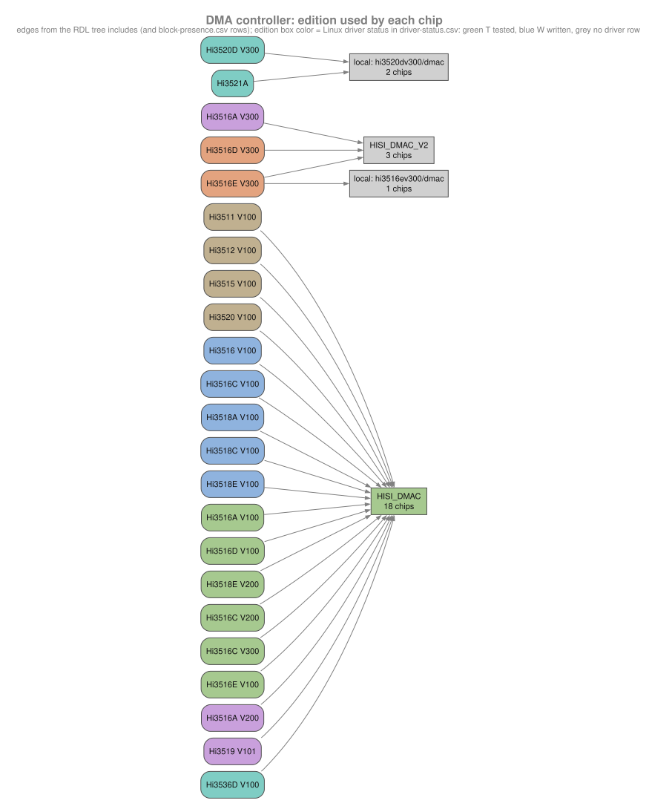

| Edition | Chips | Linux driver status (driver-status.csv) |
|---|---|---|
| HISI_DMAC | Hi3511 V100, Hi3512 V100, Hi3515 V100, Hi3520 V100, Hi3516 V100, Hi3516C V100, Hi3518A V100, Hi3518C V100, Hi3518E V100, Hi3516A V100, Hi3516D V100, Hi3518E V200, Hi3516C V200, Hi3516C V300, Hi3516E V100, Hi3516A V200, Hi3519 V101, Hi3536D V100 | Hi3511 V100 W; Hi3512 V100 W (via folder base, INFERRED); Hi3515 V100 W; Hi3520 V100 W; Hi3516 V100 W; Hi3516C V100 W; Hi3518A V100 W; Hi3518C V100 W; Hi3516A V100 W; Hi3516D V100 W (via folder base, INFERRED); Hi3518E V200 T; Hi3516C V200 T (via folder base, INFERRED); Hi3516C V300 W; Hi3516E V100 W (via folder base, INFERRED); Hi3516A V200 W; Hi3519 V101 W |
| HISI_DMAC_V2 | Hi3516A V300, Hi3516D V300, Hi3516E V300 | none recorded |
| local: hi3516ev300/dmac | Hi3516E V300 | none recorded |
| local: hi3520dv300/dmac | Hi3520D V300, Hi3521A | none recorded |

Edition differences are described in: `docs/rdl-campaign/hi3516dv300-compare.md`, `docs/rdl-campaign/hi3520dv300-compare.md`.

### MMC / SD / SDIO host

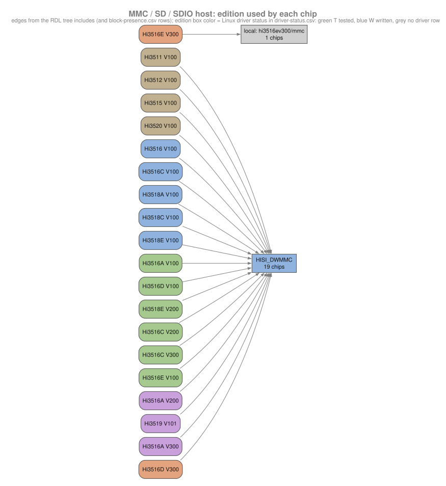

| Edition | Chips | Linux driver status (driver-status.csv) |
|---|---|---|
| HISI_DWMMC | Hi3511 V100, Hi3512 V100, Hi3515 V100, Hi3520 V100, Hi3516 V100, Hi3516C V100, Hi3518A V100, Hi3518C V100, Hi3518E V100, Hi3516A V100, Hi3516D V100, Hi3518E V200, Hi3516C V200, Hi3516C V300, Hi3516E V100, Hi3516A V200, Hi3519 V101, Hi3516A V300, Hi3516D V300 | Hi3511 V100 W; Hi3512 V100 W (via folder base, INFERRED); Hi3515 V100 W; Hi3520 V100 W; Hi3516 V100 W; Hi3516C V100 W; Hi3518A V100 W; Hi3518C V100 W; Hi3516A V100 W; Hi3516D V100 W (via folder base, INFERRED); Hi3518E V200 W; Hi3516C V200 W (via folder base, INFERRED); Hi3516C V300 W; Hi3516E V100 W (via folder base, INFERRED); Hi3516A V200 W; Hi3519 V101 W; Hi3516A V300 W |
| local: hi3516ev300/mmc | Hi3516E V300 | none recorded |

Edition differences are described in: `docs/rdl-campaign/SHARED-IP-NOTES.md`.

### Video capture (VICAP / VI)

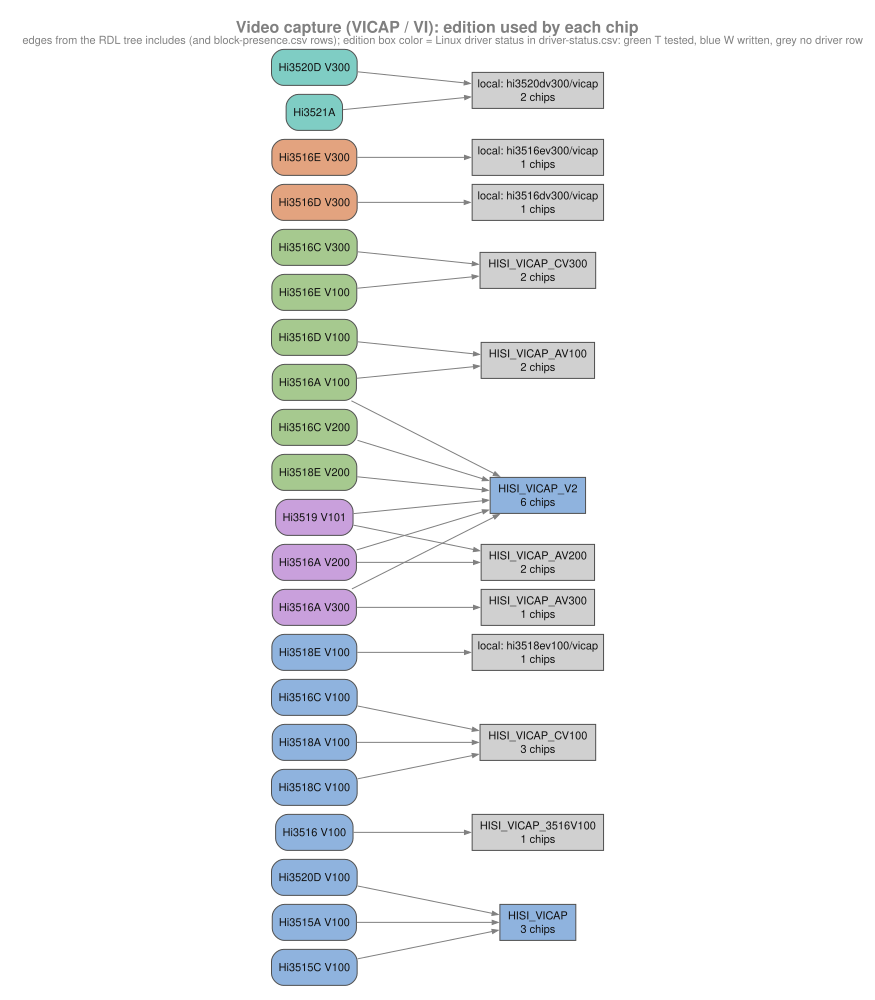

| Edition | Chips | Linux driver status (driver-status.csv) |
|---|---|---|
| HISI_VICAP | Hi3520D V100, Hi3515A V100, Hi3515C V100 | Hi3520D V100 W; Hi3515A V100 W (via folder base, INFERRED); Hi3515C V100 W (via folder base, INFERRED) |
| HISI_VICAP_3516V100 | Hi3516 V100 | none recorded |
| HISI_VICAP_AV100 | Hi3516A V100, Hi3516D V100 | none recorded |
| HISI_VICAP_AV200 | Hi3516A V200, Hi3519 V101 | none recorded |
| HISI_VICAP_AV300 | Hi3516A V300 | none recorded |
| HISI_VICAP_CV100 | Hi3516C V100, Hi3518A V100, Hi3518C V100 | none recorded |
| HISI_VICAP_CV300 | Hi3516C V300, Hi3516E V100 | none recorded |
| HISI_VICAP_V2 | Hi3516A V100, Hi3518E V200, Hi3516C V200, Hi3516A V200, Hi3519 V101, Hi3516A V300 | Hi3518E V200 W; Hi3516C V200 W (via folder base, INFERRED) |
| local: hi3516dv300/vicap | Hi3516D V300 | none recorded |
| local: hi3516ev300/vicap | Hi3516E V300 | none recorded |
| local: hi3518ev100/vicap | Hi3518E V100 | none recorded |
| local: hi3520dv300/vicap | Hi3520D V300, Hi3521A | none recorded |

Editions added from `block-presence.csv` only (not found in the chip root includes): Hi3516A V100: HISI_VICAP_V2, Hi3516A V200: HISI_VICAP_V2, Hi3516A V300: HISI_VICAP_V2, Hi3519 V101: HISI_VICAP_V2.

Edition differences are described in: `docs/rdl-campaign/SHARED-IP-NOTES.md`, `docs/rdl-campaign/hi3516dv300-compare.md`, `docs/rdl-campaign/hi3516ev300-compare.md`, `docs/rdl-campaign/hi3518ev100-compare.md`, `docs/rdl-campaign/hi3520dv300-compare.md`.

### ISP

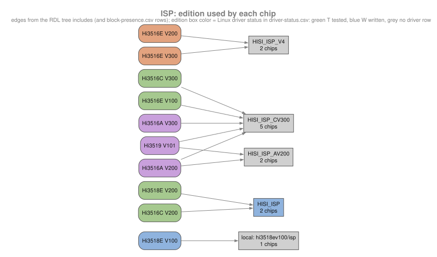

| Edition | Chips | Linux driver status (driver-status.csv) |
|---|---|---|
| HISI_ISP | Hi3518E V200, Hi3516C V200 | Hi3518E V200 W; Hi3516C V200 W (via folder base, INFERRED) |
| HISI_ISP_AV200 | Hi3516A V200, Hi3519 V101 | none recorded |
| HISI_ISP_CV300 | Hi3516C V300, Hi3516E V100, Hi3516A V200, Hi3519 V101, Hi3516A V300 | none recorded |
| HISI_ISP_V4 | Hi3516E V200, Hi3516E V300 | none recorded |
| local: hi3518ev100/isp | Hi3518E V100 | none recorded |

Editions added from `block-presence.csv` only (not found in the chip root includes): Hi3516A V200: HISI_ISP_CV300, Hi3516A V300: HISI_ISP_CV300, Hi3519 V101: HISI_ISP_CV300.

Edition differences are described in: `docs/rdl-campaign/hi3518ev100-compare.md`.

### Video display (VDP / VOU)

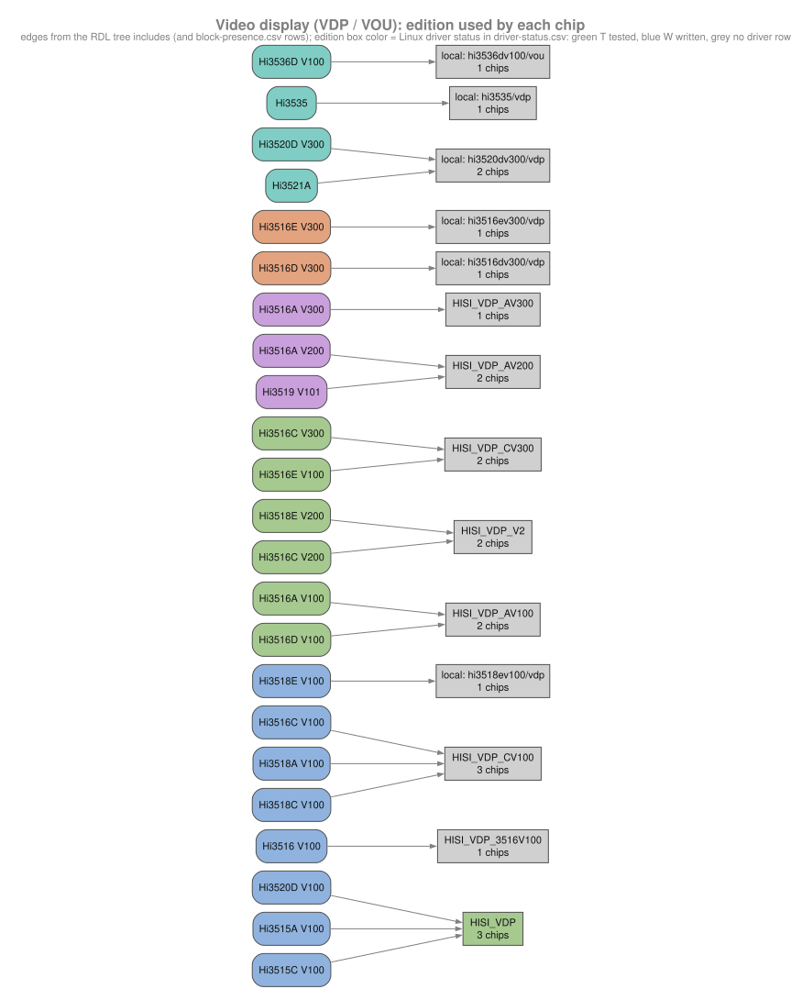

| Edition | Chips | Linux driver status (driver-status.csv) |
|---|---|---|
| HISI_VDP | Hi3520D V100, Hi3515A V100, Hi3515C V100 | Hi3520D V100 T; Hi3515A V100 T (via folder base, INFERRED); Hi3515C V100 T (via folder base, INFERRED) |
| HISI_VDP_3516V100 | Hi3516 V100 | none recorded |
| HISI_VDP_AV100 | Hi3516A V100, Hi3516D V100 | none recorded |
| HISI_VDP_AV200 | Hi3516A V200, Hi3519 V101 | none recorded |
| HISI_VDP_AV300 | Hi3516A V300 | none recorded |
| HISI_VDP_CV100 | Hi3516C V100, Hi3518A V100, Hi3518C V100 | none recorded |
| HISI_VDP_CV300 | Hi3516C V300, Hi3516E V100 | none recorded |
| HISI_VDP_V2 | Hi3518E V200, Hi3516C V200 | none recorded |
| local: hi3516dv300/vdp | Hi3516D V300 | none recorded |
| local: hi3516ev300/vdp | Hi3516E V300 | none recorded |
| local: hi3518ev100/vdp | Hi3518E V100 | none recorded |
| local: hi3520dv300/vdp | Hi3520D V300, Hi3521A | none recorded |
| local: hi3535/vdp | Hi3535 | none recorded |
| local: hi3536dv100/vou | Hi3536D V100 | none recorded |

Edition differences are described in: `docs/rdl-campaign/hi3516dv300-compare.md`, `docs/rdl-campaign/hi3518ev100-compare.md`, `docs/rdl-campaign/hi3520dv300-compare.md`.

### RTC

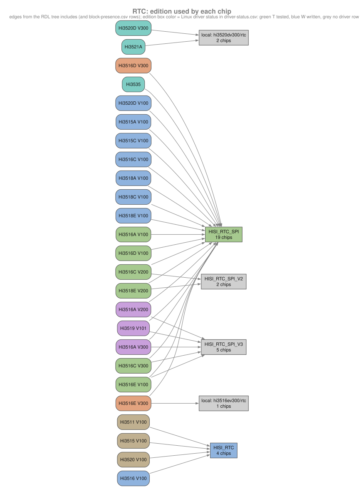

| Edition | Chips | Linux driver status (driver-status.csv) |
|---|---|---|
| HISI_RTC | Hi3511 V100, Hi3515 V100, Hi3520 V100, Hi3516 V100 | Hi3511 V100 W; Hi3515 V100 W; Hi3520 V100 W; Hi3516 V100 W |
| HISI_RTC_SPI | Hi3520D V100, Hi3515A V100, Hi3515C V100, Hi3516C V100, Hi3518A V100, Hi3518C V100, Hi3518E V100, Hi3516A V100, Hi3516D V100, Hi3518E V200, Hi3516C V200, Hi3516C V300, Hi3516E V100, Hi3516A V200, Hi3519 V101, Hi3516A V300, Hi3516D V300, Hi3516E V300, Hi3535 | Hi3520D V100 T; Hi3515A V100 T (via folder base, INFERRED); Hi3515C V100 T (via folder base, INFERRED); Hi3516C V100 W; Hi3518A V100 W; Hi3518C V100 W; Hi3516A V100 W; Hi3516D V100 W (via folder base, INFERRED); Hi3518E V200 W; Hi3516C V200 W (via folder base, INFERRED); Hi3516C V300 W; Hi3516E V100 W (via folder base, INFERRED); Hi3516A V200 W; Hi3519 V101 W; Hi3516A V300 W |
| HISI_RTC_SPI_V2 | Hi3518E V200, Hi3516C V200 | none recorded |
| HISI_RTC_SPI_V3 | Hi3516C V300, Hi3516E V100, Hi3516A V200, Hi3519 V101, Hi3516A V300 | none recorded |
| local: hi3516ev300/rtc | Hi3516E V300 | none recorded |
| local: hi3520dv300/rtc | Hi3520D V300, Hi3521A | none recorded |

Edition differences are described in: `docs/rdl-campaign/hi3518ev100-compare.md`, `docs/rdl-campaign/hi3520dv300-compare.md`, `docs/rdl-campaign/hi3535-compare.md`.

### PWM

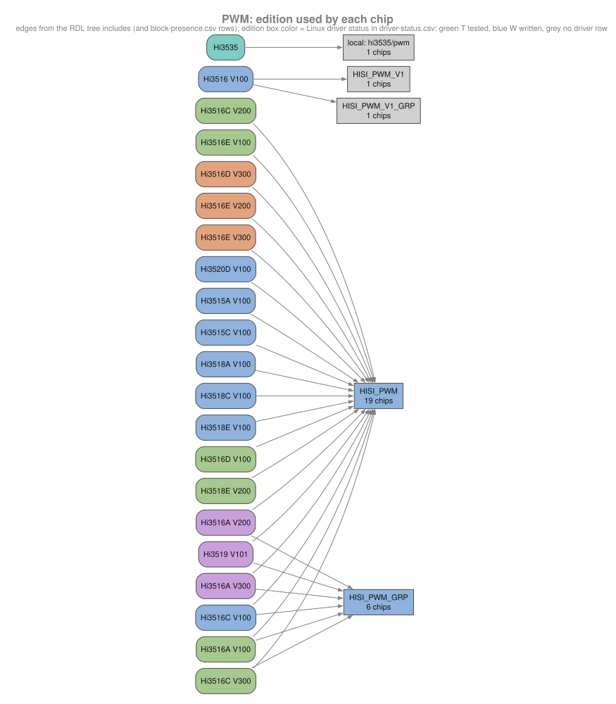

| Edition | Chips | Linux driver status (driver-status.csv) |
|---|---|---|
| HISI_PWM | Hi3520D V100, Hi3515A V100, Hi3515C V100, Hi3516C V100, Hi3518A V100, Hi3518C V100, Hi3518E V100, Hi3516A V100, Hi3516D V100, Hi3518E V200, Hi3516C V200, Hi3516C V300, Hi3516E V100, Hi3516A V200, Hi3519 V101, Hi3516A V300, Hi3516D V300, Hi3516E V200, Hi3516E V300 | Hi3520D V100 W; Hi3515A V100 W (via folder base, INFERRED); Hi3515C V100 W (via folder base, INFERRED); Hi3518E V200 W; Hi3516C V200 W (via folder base, INFERRED) |
| HISI_PWM_GRP | Hi3516C V100, Hi3516A V100, Hi3516C V300, Hi3516A V200, Hi3519 V101, Hi3516A V300 | Hi3516C V300 W; Hi3519 V101 W |
| HISI_PWM_V1 | Hi3516 V100 | none recorded |
| HISI_PWM_V1_GRP | Hi3516 V100 | none recorded |
| local: hi3535/pwm | Hi3535 | none recorded |

Editions added from `block-presence.csv` only (not found in the chip root includes): Hi3516A V100: HISI_PWM_GRP, Hi3516A V200: HISI_PWM_GRP, Hi3516A V300: HISI_PWM_GRP, Hi3516C V100: HISI_PWM_GRP, Hi3516C V300: HISI_PWM_GRP, Hi3516 V100: HISI_PWM_V1_GRP, Hi3519 V101: HISI_PWM_GRP.

### MIPI / LVDS receiver

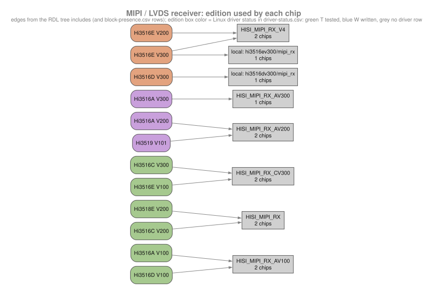

| Edition | Chips | Linux driver status (driver-status.csv) |
|---|---|---|
| HISI_MIPI_RX | Hi3518E V200, Hi3516C V200 | none recorded |
| HISI_MIPI_RX_AV100 | Hi3516A V100, Hi3516D V100 | none recorded |
| HISI_MIPI_RX_AV200 | Hi3516A V200, Hi3519 V101 | none recorded |
| HISI_MIPI_RX_AV300 | Hi3516A V300 | none recorded |
| HISI_MIPI_RX_CV300 | Hi3516C V300, Hi3516E V100 | none recorded |
| HISI_MIPI_RX_V4 | Hi3516E V200, Hi3516E V300 | none recorded |
| local: hi3516dv300/mipi_rx | Hi3516D V300 | none recorded |
| local: hi3516ev300/mipi_rx | Hi3516E V300 | none recorded |

### Video encoder (VEDU)

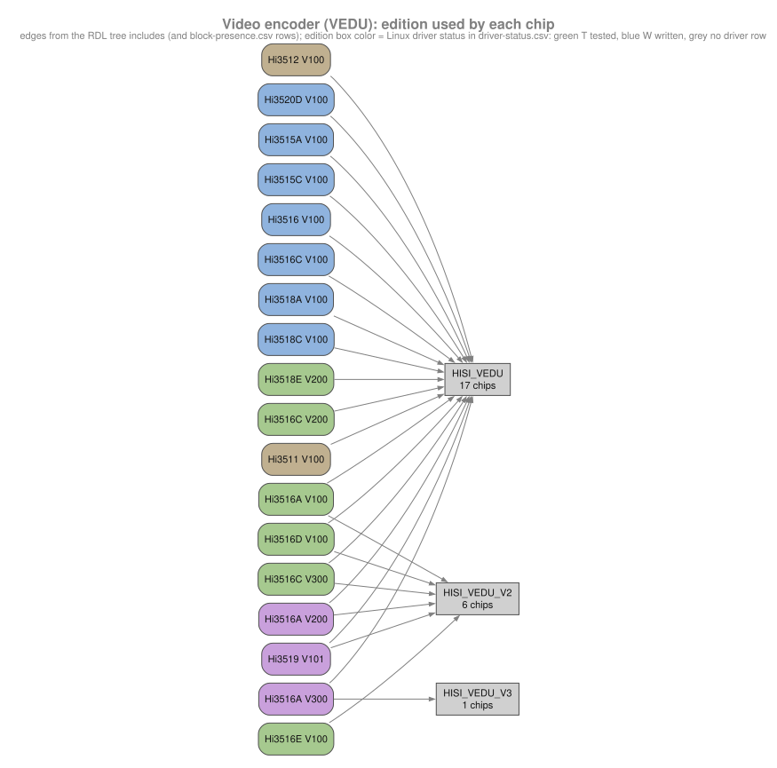

| Edition | Chips | Linux driver status (driver-status.csv) |
|---|---|---|
| HISI_VEDU | Hi3511 V100, Hi3512 V100, Hi3520D V100, Hi3515A V100, Hi3515C V100, Hi3516 V100, Hi3516C V100, Hi3518A V100, Hi3518C V100, Hi3516A V100, Hi3516D V100, Hi3518E V200, Hi3516C V200, Hi3516C V300, Hi3516A V200, Hi3519 V101, Hi3516A V300 | none recorded |
| HISI_VEDU_V2 | Hi3516A V100, Hi3516D V100, Hi3516C V300, Hi3516E V100, Hi3516A V200, Hi3519 V101 | none recorded |
| HISI_VEDU_V3 | Hi3516A V300 | none recorded |

Editions added from `block-presence.csv` only (not found in the chip root includes): Hi3516A V200: HISI_VEDU, Hi3516A V300: HISI_VEDU, Hi3516C V300: HISI_VEDU, Hi3519 V101: HISI_VEDU.

### Cipher / crypto engine

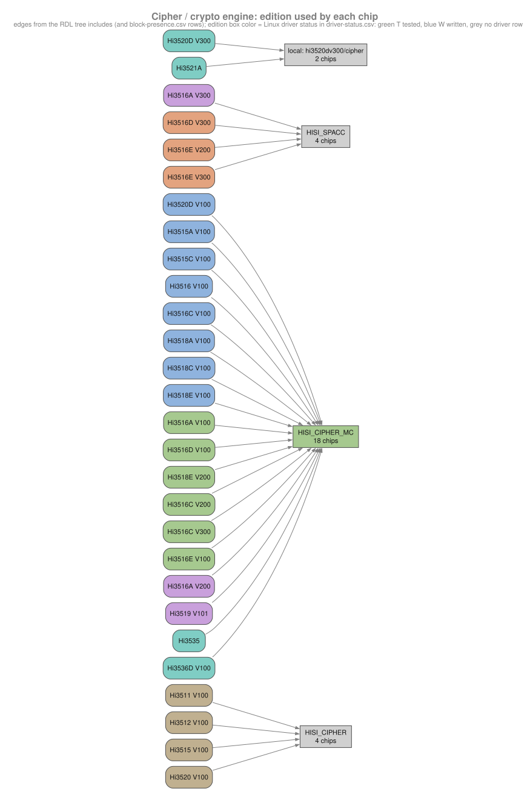

| Edition | Chips | Linux driver status (driver-status.csv) |
|---|---|---|
| HISI_CIPHER | Hi3511 V100, Hi3512 V100, Hi3515 V100, Hi3520 V100 | none recorded |
| HISI_CIPHER_MC | Hi3520D V100, Hi3515A V100, Hi3515C V100, Hi3516 V100, Hi3516C V100, Hi3518A V100, Hi3518C V100, Hi3518E V100, Hi3516A V100, Hi3516D V100, Hi3518E V200, Hi3516C V200, Hi3516C V300, Hi3516E V100, Hi3516A V200, Hi3519 V101, Hi3535, Hi3536D V100 | Hi3520D V100 T; Hi3515A V100 T (via folder base, INFERRED); Hi3515C V100 T (via folder base, INFERRED); Hi3516 V100 W; Hi3516C V100 W; Hi3518A V100 W; Hi3518C V100 W; Hi3516A V100 W; Hi3516D V100 W (via folder base, INFERRED); Hi3518E V200 T; Hi3516C V200 T (via folder base, INFERRED); Hi3516C V300 W; Hi3516E V100 W (via folder base, INFERRED); Hi3516A V200 W; Hi3519 V101 W; Hi3536D V100 W |
| HISI_SPACC | Hi3516A V300, Hi3516D V300, Hi3516E V200, Hi3516E V300 | none recorded |
| local: hi3520dv300/cipher | Hi3520D V300, Hi3521A | none recorded |

Edition differences are described in: `docs/rdl-campaign/SHARED-IP-NOTES.md`, `docs/rdl-campaign/hi3516ev300-compare.md`, `docs/rdl-campaign/hi3520dv300-compare.md`.

### USB PHY (driver edition)

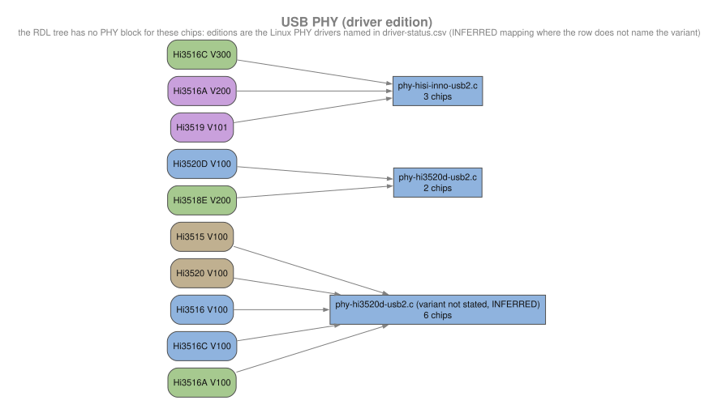

| Edition | Chips | Linux driver status (driver-status.csv) |
|---|---|---|
| phy-hi3520d-usb2.c | Hi3520D V100, Hi3518E V200 | driver: phy-hi3520d-usb2.c |
| phy-hi3520d-usb2.c (variant not stated, INFERRED) | Hi3515 V100, Hi3520 V100, Hi3516 V100, Hi3516C V100, Hi3516A V100 | driver: phy-hi3520d-usb2.c (variant not stated, INFERRED) |
| phy-hisi-inno-usb2.c | Hi3516C V300, Hi3516A V200, Hi3519 V101 | driver: phy-hisi-inno-usb2.c |

### SATA PHY (driver edition)

| Edition | Chips | Linux driver status (driver-status.csv) |
|---|---|---|
| phy-hi3520d-sata.c | Hi3520D V100 | driver: phy-hi3520d-sata.c |

## Driver coverage per IP edition

From `driver-status.csv` (Linux; status T tested on hardware, W written and builds, untested) and the headings of `docs/uboot-driver-audit.md` (U-Boot; a U-Boot port exists for the Hi3520D V100 only). A block without a row has no driver recorded; `docs/STATUS.md` section 3 holds the chip-by-driver matrix with the finer codes (S, U, Q, R, N).

| Block (edition) | Kind | Linux driver | Tested (T) on | Written (W) for | U-Boot driver (Hi3520D V100) |
|---|---|---|---|---|---|
| ARM_A9_MPCORE | generic | drivers/irqchip/irq-gic.c | Hi3520D V100 | Hi3516 V100 | - |
| ARM_GIC400 | generic | drivers/irqchip/irq-gic.c | - | Hi3516A V100, Hi3516A V200, Hi3519 V101 | - |
| ARM_PL011 | generic | drivers/tty/serial/amba-pl011.c | Hi3520D V100, Hi3518E V200 | Hi3511 V100, Hi3515 V100, Hi3520 V100, Hi3516 V100, Hi3516C V100, Hi3518A V100, Hi3518C V100, Hi3516A V100, Hi3516C V300, Hi3516A V200, Hi3519 V101, Hi3516A V300 | - |
| ARM_PL061 | generic | drivers/gpio/gpio-pl061.c | Hi3520D V100, Hi3518E V200 | Hi3511 V100, Hi3515 V100, Hi3520 V100, Hi3516 V100, Hi3516C V100, Hi3518A V100, Hi3518C V100, Hi3516A V100, Hi3516C V300, Hi3516A V200, Hi3519 V101, Hi3516A V300 | pl061_gpio.c |
| ARM_PL190 | generic | drivers/irqchip/irq-vic.c | - | Hi3511 V100, Hi3515 V100, Hi3520 V100, Hi3516C V100, Hi3518A V100, Hi3518C V100, Hi3518E V200, Hi3516C V300 | - |
| CRG | generic+ours-glue, ours | drivers/clk/hisilicon/crg-hi3516av100.c drivers/clk/hisilicon/crg-hi3516cv100.c drivers/clk/hisilicon/crg-hi3516cv300.c drivers/clk/hisilicon/crg-hi3516v100.c drivers/clk/hisilicon/crg-hi3518ev200.c drivers/clk/hisilicon/crg-hi3520d.c + clk-hisi-pll.c | Hi3520D V100, Hi3518E V200 | Hi3516 V100, Hi3516C V100, Hi3518A V100, Hi3518C V100, Hi3516A V100, Hi3516C V300 | drivers/clk/clk-hi3520d.c |
| DDRC | ours | arch/arm/mach-hisi/standby-hi3520d.c | Hi3520D V100 | - | - |
| DW_APB_I2C | generic+ours-glue | drivers/i2c/busses/i2c-designware-platdrv.c | - | Hi3511 V100, Hi3515 V100, Hi3520 V100 | - |
| HISI_AHCI_SATA | generic+ours-glue | drivers/ata/ahci_platform.c + drivers/phy/hisilicon/phy-hi3520d-sata.c | Hi3520D V100 | - | ahci_hi3520d.c |
| HISI_AIAO | ours | sound/soc/codecs/hi3518ev200-acodec.c + hi3518ev200-aiao.c | - | Hi3518E V200 | - |
| HISI_AIO | ours | sound/soc/hisilicon/hi3520d-aio.c | Hi3520D V100 | - | - |
| HISI_CIPHER_MC | ours | drivers/crypto/hisi-cipher.c | Hi3520D V100, Hi3518E V200 | Hi3516 V100, Hi3516C V100, Hi3518A V100, Hi3518C V100, Hi3516A V100, Hi3516C V300, Hi3516A V200, Hi3519 V101, Hi3536D V100 | - |
| HISI_DMAC | generic | drivers/dma/amba-pl08x.c | Hi3518E V200 | Hi3511 V100, Hi3515 V100, Hi3520 V100, Hi3516 V100, Hi3516C V100, Hi3518A V100, Hi3518C V100, Hi3516A V100, Hi3516C V300, Hi3516A V200, Hi3519 V101 | - |
| HISI_DWMMC | generic | drivers/mmc/host/dw_mmc-pltfm.c | - | Hi3511 V100, Hi3515 V100, Hi3520 V100, Hi3516 V100, Hi3516C V100, Hi3518A V100, Hi3518C V100, Hi3516A V100, Hi3518E V200, Hi3516C V300, Hi3516A V200, Hi3519 V101, Hi3516A V300 | - |
| HISI_FEMAC | generic+ours-glue | drivers/net/ethernet/hisilicon/hisi_femac.c | - | Hi3516C V100, Hi3518A V100, Hi3518C V100, Hi3518E V200, Hi3516C V300, Hi3516A V300 | - |
| HISI_FMC | generic | drivers/mtd/spi-nor/controllers/hisi-sfc.c | Hi3518E V200 | Hi3516C V300, Hi3516A V200, Hi3519 V101, Hi3516A V300 | - |
| HISI_GMAC | generic | drivers/net/ethernet/hisilicon/hix5hd2_gmac.c | - | Hi3516A V100, Hi3516A V200, Hi3519 V101 | - |
| HISI_HDMI | ours | drivers/gpu/drm/hisilicon/hi3520d/hi3520d_hdmi.c | Hi3520D V100 | - | - |
| HISI_HIETH_SF | generic+ours-glue | drivers/net/ethernet/hisilicon/hisi_femac.c drivers/net/ethernet/hisilicon/hisi_femac.c + drivers/net/mdio/mdio-hisi-femac.c | Hi3520D V100 | Hi3515 V100 | drivers/net/hifemac.c + hifemac_mdio.c |
| HISI_I2C | generic | drivers/i2c/busses/i2c-hix5hd2.c | - | Hi3520D V100, Hi3516 V100, Hi3516C V100, Hi3518A V100, Hi3518C V100 | - |
| HISI_I2C_DW | generic+ours-glue | drivers/i2c/busses/i2c-designware-platdrv.c | Hi3518E V200 | Hi3516A V100, Hi3516A V200, Hi3519 V101 | - |
| HISI_IO_CONFIG_V2 | generic | drivers/pinctrl/pinctrl-single.c | - | Hi3518E V200 | - |
| HISI_IR | generic | drivers/media/rc/ir-hix5hd2.c | - | Hi3520D V100, Hi3516 V100, Hi3516C V100, Hi3518A V100, Hi3518C V100, Hi3516A V100, Hi3518E V200, Hi3516C V300, Hi3516A V200, Hi3519 V101, Hi3516A V300 | - |
| HISI_ISP | ours | drivers/media/platform/hisilicon/hisi-isp-v2.c | - | Hi3518E V200 | - |
| HISI_IVE | ours | drivers/misc/hisi-ive/ | Hi3520D V100 | Hi3516 V100, Hi3516C V100, Hi3518A V100, Hi3518C V100, Hi3516A V100, Hi3518E V200, Hi3516C V300, Hi3516A V200, Hi3519 V101, Hi3516A V300 | - |
| HISI_JPGD | ours | drivers/media/platform/hisilicon/hisi-jpgd/ | Hi3520D V100 | Hi3536D V100 | - |
| HISI_JPGD_AV300 | ours | drivers/media/platform/hisilicon/hisi-jpgd/ | - | Hi3516A V300 | - |
| HISI_JPGE | ours | drivers/media/platform/hisilicon/hisi-jpge/ | Hi3520D V100 | Hi3516C V100, Hi3518A V100, Hi3518C V100, Hi3516A V100, Hi3518E V200, Hi3516C V300, Hi3516A V200, Hi3519 V101, Hi3536D V100 | - |
| HISI_L2CACHE_V200 | ours | arch/arm/mm/cache-hisi-l2v200.c | Hi3520D V100 | - | - |
| HISI_NANDC | generic+ours-glue | drivers/mtd/nand/raw/hisi504_nand.c | - | Hi3516 V100, Hi3516C V100, Hi3518A V100, Hi3518C V100 | - |
| HISI_PWM | generic, generic+ours-glue | drivers/pwm/pwm-hibvt.c | - | Hi3520D V100, Hi3518E V200 | - |
| HISI_PWM_GRP | generic | drivers/pwm/pwm-hibvt.c | - | Hi3516C V300, Hi3519 V101 | - |
| HISI_RNG | generic | drivers/char/hw_random/histb-rng.c | - | Hi3518E V200 | - |
| HISI_RTC | generic | drivers/rtc/rtc-pl031.c unmodified | - | Hi3511 V100, Hi3515 V100, Hi3520 V100, Hi3516 V100 | - |
| HISI_RTC_SPI | ours | drivers/rtc/rtc-hisi-spi.c | Hi3520D V100 | Hi3516C V100, Hi3518A V100, Hi3518C V100, Hi3516A V100, Hi3518E V200, Hi3516C V300, Hi3516A V200, Hi3519 V101, Hi3516A V300 | - |
| HISI_SCD | ours | drivers/misc/hisi-scd/ | Hi3520D V100 | Hi3536D V100 | - |
| HISI_SFC_300 | ours | drivers/spi/spi-hisi-sfc300.c | - | Hi3516 V100 | - |
| HISI_SFC_350 | ours | drivers/spi/spi-hisi-sfc-v3xx.c | Hi3520D V100 | Hi3516C V100, Hi3518A V100, Hi3518C V100, Hi3516A V100 | drivers/spi/hisfc350_spi.c |
| HISI_SPI | generic | drivers/spi/spi-pl022.c | Hi3520D V100 | Hi3511 V100, Hi3515 V100, Hi3520 V100, Hi3516 V100, Hi3516C V100, Hi3518A V100, Hi3518C V100, Hi3516A V100, Hi3518E V200, Hi3516C V300, Hi3516A V200, Hi3519 V101, Hi3516A V300 | - |
| HISI_TDE_G1 | ours | drivers/misc/hisi-tde/ | Hi3520D V100 | - | - |
| HISI_TDE_G2 | ours | drivers/misc/hisi-tde/ | - | Hi3518E V200, Hi3536D V100 | - |
| HISI_TIMER_SP804 | generic | drivers/clocksource/timer-sp804.c | Hi3520D V100, Hi3518E V200 | Hi3511 V100, Hi3515 V100, Hi3520 V100, Hi3516 V100, Hi3516C V100, Hi3518A V100, Hi3518C V100, Hi3516A V100, Hi3516C V300, Hi3516A V200, Hi3519 V101, Hi3516A V300 | - |
| HISI_USB_DEVICE | generic | drivers/usb/dwc2 | - | Hi3516A V100, Hi3518E V200, Hi3516C V300, Hi3516A V200, Hi3519 V101 | - |
| HISI_USB_EHCI | generic+ours-glue | drivers/usb/host/ehci-platform.c + drivers/phy/hisilicon/phy-hi3520d-usb2.c drivers/usb/host/ehci-platform.c + phy-hi3520d-usb2.c | Hi3520D V100, Hi3518E V200 | Hi3515 V100, Hi3520 V100, Hi3516 V100, Hi3516C V100, Hi3518A V100, Hi3518C V100, Hi3516A V100, Hi3516C V300, Hi3516A V200, Hi3519 V101 | ehci-generic.c (patch) |
| HISI_USB_OHCI | generic+ours-glue | drivers/usb/host/ohci-platform.c + drivers/phy/hisilicon/phy-hi3520d-usb2.c drivers/usb/host/ohci-platform.c + phy-hi3520d-usb2.c drivers/usb/host/ohci-platform.c + same PHY variants as EHCI | Hi3520D V100, Hi3518E V200 | Hi3515 V100, Hi3520 V100, Hi3516 V100, Hi3516C V100, Hi3518A V100, Hi3518C V100, Hi3516A V100, Hi3516C V300, Hi3516A V200, Hi3519 V101 | - |
| HISI_VDP | ours | drivers/gpu/drm/hisilicon/hi3520d/ | Hi3520D V100 | - | - |
| HISI_VEDU_V100 | ours | drivers/media/platform/hisilicon/hisi-vedu/ | Hi3520D V100 | Hi3518E V200 | - |
| HISI_VICAP | ours | drivers/media/platform/hisilicon/hisi-vicap/ | - | Hi3520D V100 | - |
| HISI_VICAP_V2 | ours | drivers/media/platform/hisilicon/hisi-vicap/hisi-vicap-v2.c | - | Hi3518E V200 | - |
| HISI_VPSS | ours | drivers/media/platform/hisilicon/hisi-vpss/ | - | Hi3518E V200 | - |
| HISI_VPSS_V100 | ours | drivers/media/platform/hisilicon/hisi-vpss/ | Hi3520D V100 | - | - |
| HISI_WDG_SP805 | generic | drivers/watchdog/sp805_wdt.c | Hi3520D V100, Hi3518E V200 | Hi3511 V100, Hi3515 V100, Hi3520 V100, Hi3516 V100, Hi3516C V100, Hi3518A V100, Hi3518C V100, Hi3516A V100, Hi3516C V300, Hi3516A V200, Hi3519 V101, Hi3516A V300 | sp805_wdt.c (patch) |
| IO_CONFIG | generic | drivers/pinctrl/pinctrl-single.c | Hi3520D V100 | Hi3515 V100, Hi3520 V100, Hi3516 V100, Hi3516C V100, Hi3516A V100 | - |
| IO_CONFIG_HI3518A | generic | drivers/pinctrl/pinctrl-single.c | - | Hi3518A V100, Hi3518C V100 | - |
| IO_CONFIG_HI3518C | generic | drivers/pinctrl/pinctrl-single.c | - | Hi3518A V100, Hi3518C V100 | - |
| MOTION_DETECT | ours | drivers/media/platform/hisilicon/hisi-mdu/ | Hi3520D V100 | Hi3516 V100, Hi3516C V100, Hi3518A V100, Hi3518C V100, Hi3516A V100 | - |
| PERI_CRG | generic+ours-glue | drivers/clk/hisilicon/clk-hi3519.c | - | Hi3519 V101 | - |
| SYS_CTRL | generic | drivers/mfd/syscon.c + drivers/power/reset/syscon-reboot.c | Hi3520D V100 | - | - |
| local:CRG | generic+ours-glue, ours | drivers/clk/hisilicon/crg-hi3516av100.c drivers/clk/hisilicon/crg-hi3516av300.c drivers/clk/hisilicon/crg-hi3516cv100.c drivers/clk/hisilicon/crg-hi3516cv300.c drivers/clk/hisilicon/crg-hi3516v100.c drivers/clk/hisilicon/crg-hi3518ev200.c drivers/clk/hisilicon/crg-hi3520d.c + clk-hisi-pll.c | Hi3520D V100, Hi3518E V200 | Hi3516 V100, Hi3516C V100, Hi3518A V100, Hi3518C V100, Hi3516A V100, Hi3516C V300, Hi3516A V300 | drivers/clk/clk-hi3520d.c |
| local:IO_CONFIG | generic | drivers/pinctrl/pinctrl-single.c | Hi3520D V100 | Hi3515 V100, Hi3520 V100, Hi3516 V100, Hi3516C V100, Hi3518A V100, Hi3518C V100, Hi3516A V100 | - |
| local:peri_crg | generic+ours-glue | drivers/clk/hisilicon/clk-hi3519.c | - | Hi3519 V101 | - |

U-Boot drivers found in `docs/uboot-driver-audit.md` and not matched to a driver-status block above: phy-hi3520d-usb2.c (USB2 PHY), phy-hi3520d-sata.c (SATA PHY).
